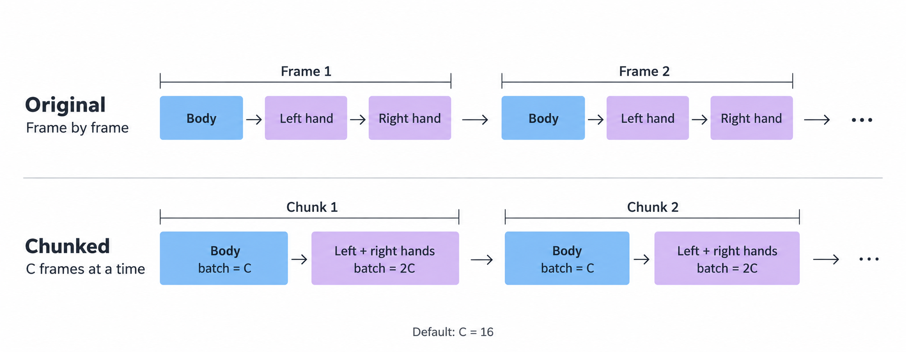

# Inference Performance

NVIDIA A100-SXM4-80GB, PyTorch 2.5.1+cu118, no TensorRT.
All timings exclude model loading and warmup.
VRAM is peak NVML process memory (including caches), except where labeled allocated.

For 300 frames, chunk 32 gives **9.7× faster SAM feature extraction** with
compilation (154.45 → 15.90 s), and **6.1× faster end-to-end inference** with a
static camera and compilation (166.90 → 27.22 s).

## SAM chunk inference

Default: **chunk = 16**; the final chunk may be smaller.

300 frames, 1080p / 30 FPS; SAM-only time, excluding decoding and file I/O.
Original: one earlier run; Lite: median of three runs.
Lite VRAM was measured in a shared benchmark process and includes cached compiled kernels.
Set `--sam_chunk_size 32` in the CLI or **SAM chunk** to `32` in the Web Settings.
Compilation is off by default and applies only to the backbone.

| SAM | Chunk | Eager (s) | VRAM (GiB) | Compiled (s) | VRAM (GiB) |
|---|---:|---:|---:|---:|---:|
| Original (full) | 1 | 154.45 | 4.10 | — | — |
| Lite | 4 | 34.71 | 5.02 | 30.32 | 4.63 |
| Lite | 8 | 26.26 | 6.02 | 22.07 | 5.20 |
| Lite | 16 | 21.77 | 8.01 | 17.78 | 6.32 |
| Lite | 32 | 19.77 | 11.96 | 15.90 | 8.81 |

## End-to-end inference

300 frames, `flowhmr_latest`, 20 steps, CFG 1. Lite uses chunk 32 with SAM backbone
compilation enabled. One run per setting, from video preprocessing to NPZ/FBX
export, without postprocessing or rendering.
Original baselines are from earlier runs; compiled rows use FFmpeg 7.0.2.

| Camera | SAM | Camera (s) | SAM (s) | Total (s) | VRAM (GiB) |
|---|---|---:|---:|---:|---:|
| Static | Original | 0.02 | 156.28 | 166.90 | 6.16 |
| Static | Lite + compile | 0.02 | 16.68 | 27.22 | 10.82 |
| VGGT, interval 1 | Original | 30.27 | 195.22 | 237.87 | 31.69 |
| VGGT, interval 1 | Lite + compile | 26.93 | 16.73 | 53.97 | 31.76 |
| VGGT, interval 10 | Lite + compile | 2.09 | 16.68 | 29.47 | 17.22 |

## Long-sequence generation

Thanks to [@Scar1etCrystal](https://github.com/Scar1etCrystal) for the query-batched
attention prototype and experiments in [issue #4](https://github.com/flowhmr/flowhmr/issues/4).

Generation only: FP32, 20 steps, CFG 1, query chunk 256; median of three runs.
The 3,600-frame case is a synthetic stress test using repeated 300-frame inputs.

| Model | Frames | Original (s) | Query-batched (s) | Allocated VRAM (GiB), original → query-batched |
|---|---:|---:|---:|---:|
| base | 300 | 0.716 | 0.959 | 1.99 → 1.94 |
| latest | 300 | 0.793 | 1.036 | 1.99 → 1.94 |
| base | 3,600 | 19.070 | 7.570 | 13.87 → 2.78 |
| latest | 3,600 | 19.102 | 7.581 | 13.87 → 2.78 |

See the [inference guide](inference.md) and [Web guide](web_demo.md) for configuration.
