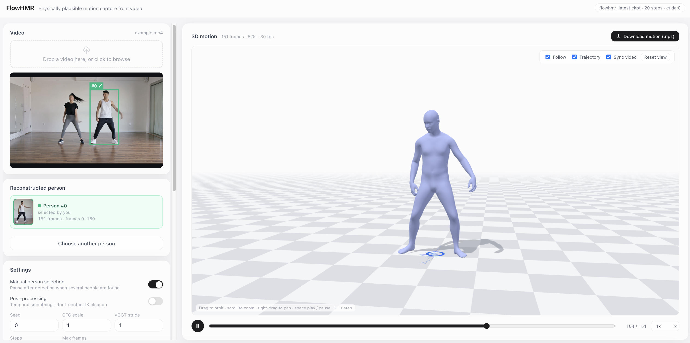

# Web Demo

Copy this into your coding agent:

```text
Launch the FlowHMR Web demo in my checkout. Follow docs/install.md for the V2M
setup and docs/web_demo.md for launch and verification.
Check the required model files, select an available GPU and port, then start
app.py. Use assets/example/example.mp4 to verify motion generation and playback.
Read docs/params.md if settings need adjustment. Report the demo URL, logs,
and saved result path, or explain any remaining blockers.
```

## What the demo does

Upload a video to run person detection and tracking → Pi4 camera
estimation → SAM-3D-Body features → FlowHMR motion generation. The page shows
the reconstructed SMPL-H motion in a 3D viewer beside the input video.

<p align="center">
  
</p>

- **Settings per run**: seed, CFG scale, ODE steps, max frames / automatic full video, Camera stride,
  static camera, SAM chunk and post-processing are set in the collapsible Settings card.
- **Person selection**: when more than one person is detected and *Manual person
  selection* is on, the job pauses after detection. Pick the target person from the
  list (each entry shows a crop of that person) or click their box in the video
  preview, then confirm. Without a choice within 10 minutes, the suggested person
  (longest / largest track) is used. With the switch off, it is chosen automatically.
  Detection time excludes the wait for selection.
- **Re-run**: a finished run can be re-run from *Recent runs* with the current
  settings; matching detection, camera and feature caches are reused. Changing
  camera mode uses separate camera/SAM caches.
- Run history and results persist in `output/web_jobs/` across server restarts.
- **Stop / Cancel**: stop a running job or cancel a queued job from the page.

This is the **self-hosted** demo. The hosted Hugging Face demo is listed separately
in the [overview](../README.md#overview).

## Launch

Complete the V2M setup in [install.md](install.md), including the perception
submodules and checkpoints. Run commands from the **repository root**:

```bash
conda activate flowhmr
python app.py
```

The default checkpoint is `checkpoints/flowhmr_latest/flowhmr_latest.ckpt`.
After the log prints `FlowHMR web demo ready`, open `http://localhost:8080`
on the same machine, or `http://<host>:8080` when connecting remotely.
The page queues jobs on the selected GPU.
New jobs default to YOLO26m and Pi4. Select **YOLOX-L** or **VGGT-Omega** to reuse
an earlier setup. Recovered jobs retain their original backend choices.

## Verify a run

1. Upload `assets/example/example.mp4`.
2. Wait for detection, camera estimation, feature extraction, and generation.
3. Check that the input video and reconstructed motion both play in the page.
4. Find the exported motion at `output/web_jobs/<job_id>/motion.npz` by default.

## Adjust settings

All run settings are in the page's Settings card; see [params.md](params.md#web-demo).
**Post-processing** enables RGBMocap contact planning and anatomical IK (off by default;
requires the [optional dependency](install.md#optional-post-processing)).
Defaults: **SAM chunk = 16** frames; hand batch is automatically **32** crops.
Query batching and compile are **off**. Set **SAM chunk** to `32` for body32/hand64.
Changing the chunk size on re-run recomputes SAM
features while retaining matching detection and camera caches.
If SAM runs out of GPU memory, lower **SAM chunk**, e.g. `16` → `8` → `4`.

Choose the detector and camera backend in **Settings**. For a fixed camera, select **Static**. It skips VGGT and uses a constant pose with SAM's default
approximate intrinsics.

For long videos or limited GPU memory, increase **Camera stride** (e.g. `10` or `30`)
so camera estimation processes fewer frames and interpolates in between. This
setting applies to VGGT-Omega and Pi4. If camera estimation runs out of GPU memory,
select **Settings → Camera → SimpleVO**. It estimates camera rotation on the CPU every eight frames.

Optional acceleration is configured before starting the service:

| Environment variable | Default | Setting |
|---|---|---|
| `FLOWHMR_SAM_COMPILE` | `0` | `1` to compile the SAM backbone |
| `FLOWHMR_ATTENTION_BACKEND` | `original` | `query_batched` for long-sequence generation |
| `FLOWHMR_ATTENTION_QUERY_CHUNK_SIZE` | `256` | Queries per batch when `query_batched` is enabled |

```bash
FLOWHMR_SAM_COMPILE=1 FLOWHMR_ATTENTION_BACKEND=query_batched python app.py
```

Restart the service after changing these variables; compilation adds first-use
startup time. Model YAML attention settings override the environment variables.
See the [performance report](performance.md) for batch, timing and VRAM comparisons.

See [camera settings](params.md#camera-settings) for the tradeoff and other
camera reconstruction approaches. Missing core model files are listed at startup;
VGGT weights are checked when camera estimation is requested. Use
[resources.md](resources.md) to locate them and [install.md](install.md)
to prepare them.
